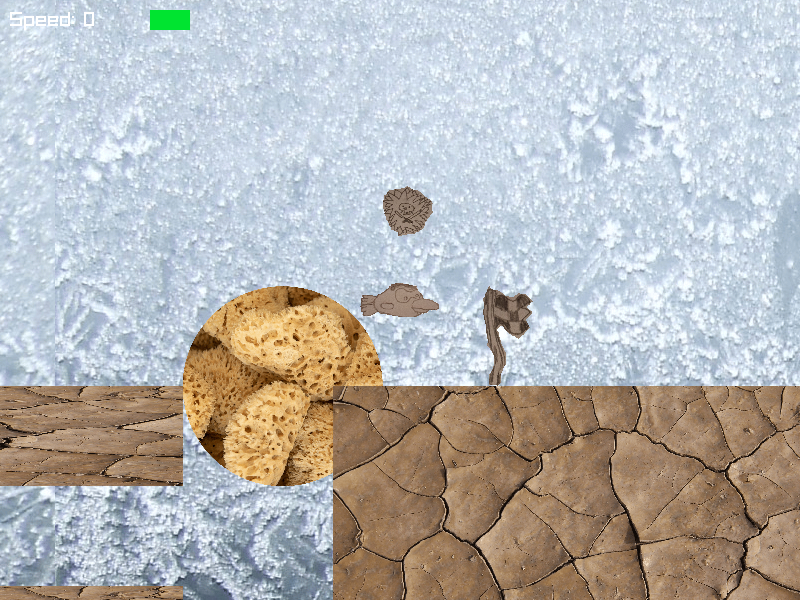

# Frosh

Frosh is a 2D tiled space-flight racing game.

### How to build and run (Cmake, make, and a C compiler is required and a unix-like Operating system)

1. Create a directory called `build` and cd into it
2. run `cmake ..`
3. run `make`
4. run `./frosh-game`

#### TODO

- add characters
- make some levels
- add some music
